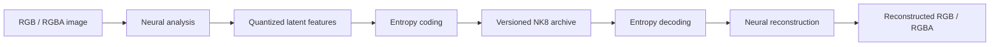

# Architecture overview

NK8 is a learned image codec paired with a specialized execution runtime. This overview describes its approach without publishing implementation code or a complete bitstream specification.

## Encode and decode

The analysis network produces latent features. A learned probability model helps encode them compactly with entropy coding. The decoder reverses the entropy stage and reconstructs pixels with the synthesis network. This is an image codec, not a text-guided image generator.

NK8 1.0.0 derives from the existing NACRE model and uses the experimental extrapolated L8 operating profile. L8 is a project-specific operating point, not a universal quality scale or a newly retrained model.

## Runtime engineering

The qualified runtime combines GPU neural computation with native CPU entropy processing. Its optimizations include fused GPU operations, prepared execution graphs, reusable buffers, persistent model state and overlapping work.

Work queues and caches have explicit bounds. Images can be reconstructed, consumed and released progressively instead of retaining the complete decoded corpus in memory.

The public repository deliberately omits kernel code, detailed tuning parameters, canonical entropy tables, model artifacts and deployment tooling.

## Numerical compatibility

Neural reconstruction and entropy decoding have different numerical requirements. Entropy decoding must use precisely compatible integer probability tables. The release preserves canonical tables and binds execution to the qualified model and numerical contract.

The reference checks compare reconstructed pixels against qualified NK8 outputs. They establish reproducible decoding within the tested contract. They do not establish lossless RGB compression or compatibility with arbitrary future hardware.

## Images and metadata

The qualified input domain is RGB8/RGBA8. Higher-bit-depth inputs are outside the release's supported contract. Original ICC, EXIF and XMP bytes are preserved as metadata; the decode workflow also provides those original bytes separately from its PNG output.

Preserving a color profile is distinct from demonstrating acceptable color reproduction or print fidelity. Those requirements depend on the intended workflow.

## Platform boundary

The preserved software environment uses Python 3.12, PyTorch 2.14.0 with CUDA 13.0, Triton 3.8.0 and CompressAI 1.2.8. Qualified restoration targets include x86-64 RTX 5090 and ARM64 GB10 Linux environments. The optimized RTX 5090 decoder is qualified separately from the reference Spark decoder.

A portable CPU-only decoder, an independently implemented public decoder and a public format specification are not provided at this stage.
