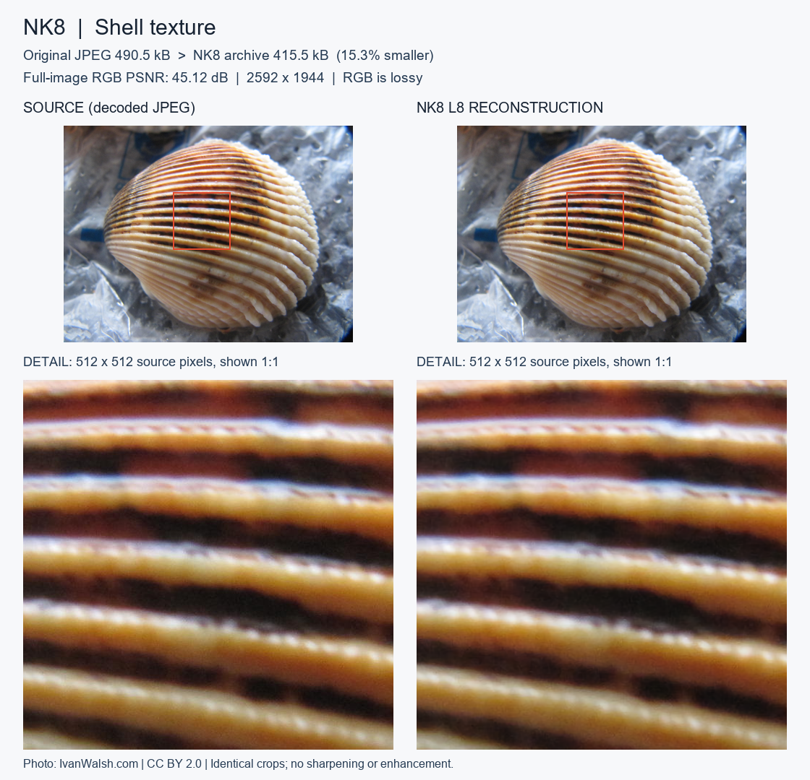
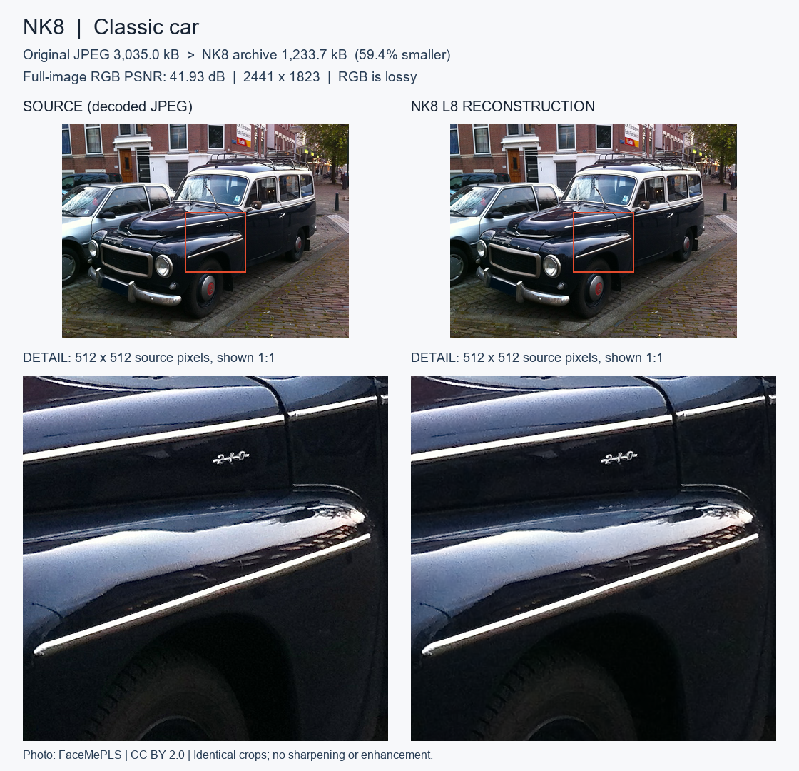
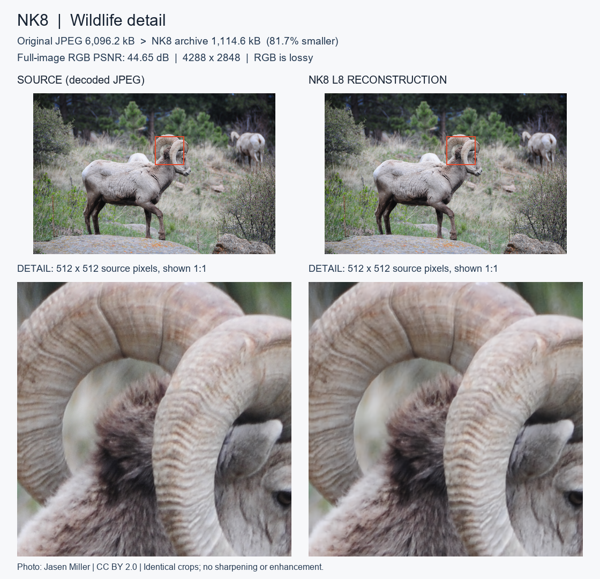

# Visual examples

These comparisons use three public, CC BY 2.0 photographs from the existing validation corpus. They were selected for content variety, not as a representative sample or a new benchmark. No new encoding or timing campaign was performed to make the figures.

On 16 October 2026, their existing NK8 L8 archives were decoded and the full reconstructed RGB arrays were checked against the preserved reference pixel hashes. All three matched. Full-image PSNR was independently recalculated from the source and reconstructed pixels and matched the saved measurements.

## How to read the figures

- **Left:** normalized pixels decoded from the original JPEG file.
- **Right:** reconstruction from the saved NK8 archive.
- The upper row is a downscaled overview with the selected region outlined.
- The lower row shows identical **512 x 512 native-pixel crops at 1:1** inside the downloaded figure. Browser or Reddit display scaling may resize the whole figure; open the original PNG for pixel inspection.
- No sharpening, denoising, color enhancement, generated imagery or added lossy recompression was applied to the comparison panels. Overviews are resampled only for presentation. Panels are saved as lossless RGB PNGs.
- File-size labels compare the **original JPEG file with the complete NK8 archive**, not with the PNG used to display the example. PSNR refers to the full image, not only the displayed crop.

## Per-image measurements

| Example | Dimensions | Original JPEG | Complete NK8 archive | Size reduction | Full-image RGB PSNR |
|---|---:|---:|---:|---:|---:|
| Shell texture | 2592 x 1944 | 490,466 B | 415,488 B | 15.29% | 45.1193 dB |
| Classic car | 2441 x 1823 | 3,035,048 B | 1,233,728 B | 59.35% | 41.9289 dB |
| Wildlife detail | 4288 x 2848 | 6,096,195 B | 1,114,560 B | 81.72% | 44.6509 dB |

These individual JPEG examples do not reproduce the aggregate reduction of the mixed 2,506-image corpus. Already-compressed source files differ considerably in how much additional size reduction is possible. RGB compression remains lossy, and a high PSNR does not imply that every fine detail is unchanged.

## Shell texture

Original: ["180" by IvanWalsh.com](https://www.flickr.com/photos/ivanwalsh/4225450808), [CC BY 2.0](https://creativecommons.org/licenses/by/2.0/). Changes: NK8 reconstruction on the right, identical crops, resized overview and comparison labels. Original corpus ID: `open_images/c37c300dfdc8d819`.

## Classic car

Original: ["Volvo P 21134 (1964)" by FaceMePLS](https://www.flickr.com/photos/faceme/7562216950), [CC BY 2.0](https://creativecommons.org/licenses/by/2.0/). Changes: NK8 reconstruction on the right, identical crops, resized overview and comparison labels. Original corpus ID: `open_images/5e472cbdc51dbe02`.

## Wildlife detail

Original: ["The line must be drawn here! This far and no further!" by Jasen Miller](https://www.flickr.com/photos/cptspock/2532055226), [CC BY 2.0](https://creativecommons.org/licenses/by/2.0/). Changes: NK8 reconstruction on the right, identical crops, resized overview and comparison labels. Original corpus ID: `open_images/0d035b68ebd76f87`.

## Attribution and reproducibility

Source authors, source pages and CC BY 2.0 licenses are recorded in the preserved corpus manifest. The public [example manifest](../examples/manifest.json) includes dimensions, crop coordinates, exact sizes, PSNR, reconstructed-pixel hashes and figure hashes. It contains no model weights, entropy tables or implementation code.

The comparison PNGs are also offered under CC BY 2.0. Credit the original photographers and identify NK8 reconstruction and presentation changes when sharing them. They are photographic examples, not AI-generated illustrations.
